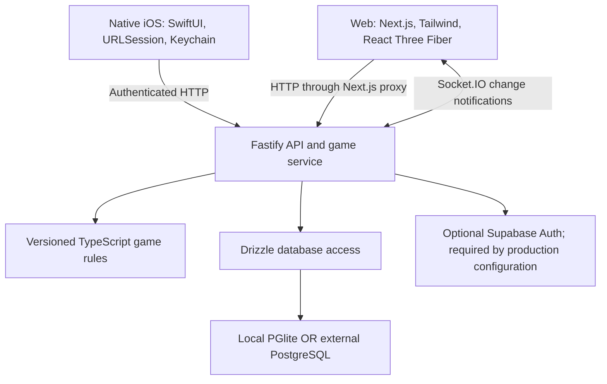

# Brain Battle — project context and handoff

**Repository snapshot: November 12, 2026.** This document describes the implementation currently present in this repository, including the native iOS pivot, preserved web client, shared backend, validation history, and unfinished work. It is intended for teammates and for providing context in a new development conversation.

This is a code and implementation snapshot, not a statement that a production service or App Store release is available. Validation dates below distinguish earlier full-flow runs from the latest renderer checks. No application tests were rerun just to produce this document.

Current November 11 gameplay update: **new matches use Counting Boxes v2**, with sparse 5×5 placement, 3–16 cubes, faster versioned timing, stationary rendering, and +1/keypad counting. v1 remains supported without rewriting existing rows or clocks. See [COUNTING_BOXES_V2.md](apps/ios/COUNTING_BOXES_V2.md). Earlier v1 polish/proposal sections below are historical context.

## Contents

1. [Product direction and current milestone](#1-product-direction-and-current-milestone)
2. [Implemented functionality](#2-implemented-functionality)
3. [The playable challenge flow](#3-the-playable-challenge-flow)
4. [Architecture and repository map](#4-architecture-and-repository-map)
5. [Counting Boxes rules](#5-counting-boxes-rules)
6. [Authoritative state, timing, and fairness](#6-authoritative-state-timing-and-fairness)
7. [Backend HTTP API](#7-backend-http-api)
8. [Authentication and identity](#8-authentication-and-identity)
9. [Database and migrations](#9-database-and-migrations)
10. [Native iOS implementation](#10-native-ios-implementation)
11. [Web implementation and multiplayer transport](#11-web-implementation-and-multiplayer-transport)
12. [Starting local development](#12-starting-local-development)
13. [Environment configuration](#13-environment-configuration)
14. [Testing with two players and two Simulators](#14-testing-with-two-players-and-two-simulators)
15. [Working with teammates](#15-working-with-teammates)
16. [Physical iPhones and distribution](#16-physical-iphones-and-distribution)
17. [Tests and recorded verification](#17-tests-and-recorded-verification)
18. [Known limitations and recovery context](#18-known-limitations-and-recovery-context)
19. [Suggested next milestones](#19-suggested-next-milestones)
20. [Contributor guardrails and copyable context](#20-contributor-guardrails-and-copyable-context)

## 1. Product direction and current milestone

Brain Battle is a competitive cognitive mini-game application. The longer-term product has live battles for 2–8 players, asynchronous friend challenges, and five rounds of mixed mini-games. The initial games planned were Counting Boxes, Reaction Time, and Sequence Memory.

The current product direction is **iOS-first, using Swift and SwiftUI**, with eventual Apple App Store distribution. The existing Next.js web application and Fastify backend remain in place. Native iOS and web clients use the same server rules, matches, invitations, and scoring.

The implemented vertical slice is:

> Guest A creates a five-round Counting Boxes challenge, plays, shares an invitation, and Guest B claims it and plays the same five puzzles. Each sees their own round feedback; both receive the final comparison after both finish. Either can create a rematch with fresh puzzles.

This flow is asynchronous: each player starts their own round timer. Players may have the app open simultaneously, but there is no synchronized live-room game mode yet. Solo practice also works and uses server-validated attempts.

The November 9 native homepage redesign adds a Social Rivalry layout, real recent head-to-head statistics, pending turns, completed battle badges, and Home/Games/Friends/Profile navigation. Its data comes from the existing latest-eight-match API plus authorized match details, so it is a recent-history view rather than an all-time rivalry leaderboard or exhaustive challenge inbox. See [native home implementation notes](apps/ios/SOCIAL_HOME.md).

The November 9 [native gameplay polish](apps/ios/GAMEPLAY_POLISH.md) preserved v1 rules. The subsequent [Counting Boxes v2](apps/ios/COUNTING_BOXES_V2.md) implementation now supplies sparse 5×5 placement, fixed-camera Quick Count/Type Answer, fast round progression, and version-specific scoring for new matches. The older difficulty proposal is historical; no schema migration or rewrite of existing v1 matches was needed.

## 2. Implemented functionality

| Capability                            | Current state                                                                                   |
| ------------------------------------- | ----------------------------------------------------------------------------------------------- |
| Native iOS app                        | Implemented in SwiftUI; iPhone target, iOS 18 minimum                                           |
| Responsive web app                    | Preserved and playable using the same backend                                                   |
| Home screen                           | Challenge, solo, profile, recent matches, and live-mode coming-soon presentation                |
| Guest identity                        | Local development sessions; optional Supabase anonymous authentication on the backend           |
| Player profile                        | Persistent identifier and editable display name                                                 |
| Counting Boxes                        | Versioned, deterministic server generation and scoring                                          |
| Native cube graphics                  | Core Animation 3D layers, stationary isometric camera, subtle v2 ground grid                    |
| Web cube graphics                     | React Three Fiber; isometric SVG fallback                                                       |
| Challenge format                      | Five Counting Boxes rounds, two participants                                                    |
| Solo practice                         | Five rounds, one participant                                                                    |
| Invitations                           | Expiring, claimable link; one other player can claim it                                         |
| Native sharing                        | System share sheet through SwiftUI `ShareLink`                                                  |
| Joining on iOS                        | Paste a link or use the custom URL scheme; public universal links need deployment configuration |
| Match persistence                     | Profiles, matches, private round seeds, attempts, and original deadlines                        |
| Refresh/relaunch                      | Resume server state and existing deadlines                                                      |
| Feedback and results                  | Own finalized round result; protected opponent results; final winner/draw                       |
| Rematch                               | New match, new seeds, new invitation; previous opponent joins again                             |
| Socket.IO                             | Authenticated web match subscriptions and change notifications                                  |
| Live battles for 2–8                  | Not implemented                                                                                 |
| Reaction Time / Sequence Memory       | Not implemented                                                                                 |
| Mixed-game rounds                     | Not implemented; all five rounds currently use Counting Boxes                                   |
| Registered-account onboarding/linking | Not implemented in client UI                                                                    |
| Production deployment / TestFlight    | Not configured as a completed deployment                                                        |
| Android app / Expo / React Native     | Not implemented; the mobile client is native SwiftUI                                            |

As of November 11, native Open Battles rows support local **Dismiss** and **Undo**. Dismissal persists per player/server on this iPhone and filters ongoing home rows, while preserving the match, invitation, opponent access, results, and rivalry statistics. The build, all 15 unit tests, and two selected home/dismissal UI tests passed; see [the home notes](apps/ios/SOCIAL_HOME.md).

Current v2 verification: 20 TypeScript/backend/engine tests, 18 Swift units, two browser tests, production web build, and an unsigned Release iPhone build succeeded. Native feature scenarios passed across focused runs; the final compact-height adjustment still needs a clean compact UI rerun after Simulator stalled and automatic restart approval timed out. See [v2 validation details](apps/ios/COUNTING_BOXES_V2.md).

## 3. The playable challenge flow

1. A client creates or restores a guest session. The backend determines the player identity.
2. The player sets a display name and chooses **Challenge a friend**.
3. The backend creates a match, five private round seeds, and a random invitation token. The match and invitation expire 48 hours after creation.
4. The host starts round one. This persists that player's display and answer deadlines.
5. The app displays server-provided cube coordinates using the stored rules: v2 Easy is 3/6 seconds, Medium 2.5/6 seconds, and Hard 2/5 seconds for observation/answer. Counting is available during observation. Saved v1 matches retain 8/12 seconds.
6. The player submits a cube count. The server regenerates the expected answer from the stored seed and calculates the score using server time.
7. The host repeats this for all five rounds. Their own results are available while they wait for the opponent.
8. The host shares the invitation URL. Sharing is available through the native share sheet; the web client supports copying the link.
9. Another guest previews and claims the invitation. Claiming is atomic, so two different guests cannot take the same seat.
10. The guest receives the same round geometry with their own independent timers and completes all five rounds.
11. Both clients fetch the completed comparison: totals and winner, or a draw.
12. Rematch creates a new challenge. It does not silently enroll the previous opponent.

Host and guest do not have to use the same platform. An iOS player can challenge a web player when both reach the same backend and invitation origin.

## 4. Architecture and repository map



The backend owns identity, authorization, seeds, attempt lifecycle, timing, scoring, invitation claims, and result visibility. Clients own navigation, drafts, countdown presentation, and rendering. Neither client talks directly to the game database.

The JavaScript/TypeScript side uses npm workspaces. The Xcode app sits in the same repository but is built by Xcode, not by npm.

```text
.
├── apps/
│   ├── api/
│   │   └── src/
│   │       ├── index.ts          # Environment, database, startup/shutdown
│   │       ├── app.ts            # Fastify, auth, routes, Socket.IO
│   │       └── service.ts        # Transactional challenge orchestration
│   ├── web/
│   │   └── src/
│   │       ├── app/              # Home, invite, match routes and styling
│   │       ├── components/       # Game stage, shell, cube renderer
│   │       └── lib/api.ts        # Authenticated browser API wrapper
│   └── ios/
│       ├── BrainBattle.xcodeproj/
│       ├── BrainBattle/
│       │   ├── App/              # Entry point and origin configuration
│       │   ├── Models/           # Codable DTOs, links, server clock
│       │   ├── Networking/       # URLSession actor and Keychain
│       │   ├── ViewModels/       # App and match presentation state
│       │   ├── Games/CountingBoxes/
│       │   ├── Views/            # Native screens
│       │   ├── Design/           # Theme and reusable controls
│       │   └── Resources/        # Icon, Info.plist, privacy manifest
│       ├── Configuration/        # Debug/release settings and simulator entitlements
│       ├── BrainBattleTests/
│       ├── BrainBattleUITests/
│       └── scripts/              # Project and icon generators
├── packages/
│   ├── shared/src/index.ts       # Zod inputs, public DTOs, constants, events
│   ├── games/src/index.ts        # MiniGame interface, registry, generator, score
│   └── db/
│       ├── src/                  # Schema, connectors, migration runner, lock
│       └── migrations/0001_initial.sql
├── tests/                        # Vitest suites
│   └── browser/                  # Playwright flows
└── .env.example                  # Documented backend/web environment
```

Useful entry points:

- [Game service](apps/api/src/service.ts): start here for challenge lifecycle and result projection.
- [HTTP/auth layer](apps/api/src/app.ts): route validation and session transports.
- [Pure game engine](packages/games/src/index.ts): generation and scoring without UI dependencies.
- [Public protocol](packages/shared/src/index.ts): accepted inputs and data clients may receive.
- [Native match screen](apps/ios/BrainBattle/Views/MatchView.swift) and [view model](apps/ios/BrainBattle/ViewModels/MatchViewModel.swift): native gameplay presentation.
- [Native cube renderer](apps/ios/BrainBattle/Games/CountingBoxes/CubeSceneView.swift): graphics only.
- [Root README](README.md), [iOS README](apps/ios/README.md), and [recovery note](apps/ios/RECOVERY-NOTE.md): shorter setup and operational references.

## 5. Counting Boxes rules

The current default is **`counting-boxes@2`**, with v1 retained for existing matches. See [the v2 rules and implementation](apps/ios/COUNTING_BOXES_V2.md) for the sparse grid, 3–16 cubes, fast difficulty progression, and +1/keypad interaction. The following geometry and timing table describe **legacy v1**. A generic `MiniGame<PublicPuzzle, Answer>` interface provides `generate` and `score`; a registry selects a rules implementation by game ID and version. Both released rule versions are registered.

The server creates cryptographically random round seeds. The pure generator derives repeatable geometry from the game ID, rules version, seed, and round number. No client chooses a seed.

The puzzle is an integer-coordinate cube stack:

- Rounds 1–3 use a 3×3 footprint; rounds 4–5 use 4×4.
- Columns contain all supporting cubes, with no floating cubes.
- Heights rise away from the fixed front camera so hidden supporting cubes can be inferred.
- Height limits vary with position and round, up to four cubes.
- The expected answer is the total number of cubes, including hidden support.

Both players receive the same coordinates for the same round. The iOS and web renderers draw that geometry rather than implementing their own random generation.

| Rule                              | Value                                         |
| --------------------------------- | --------------------------------------------- |
| Rounds                            | 5                                             |
| Display window                    | 8,000 ms                                      |
| Answer window                     | 12,000 ms after display ends                  |
| Submitted answer                  | Integer 0–100; API also accepts `null`        |
| Correct answer score              | `1000 + round(500 × (1 − elapsedMs / 12000))` |
| Wrong, null, or expired answer    | 0                                             |
| Maximum per round / match         | 1,500 / 7,500                                 |
| Challenge and invitation lifetime | 48 hours from creation                        |

`elapsedMs` is measured from the stored display end to server receipt of the answer. Submissions before answer entry opens are rejected. At or after the answer deadline, the attempt scores zero. Network transit consumes part of the answer window. Equal final totals produce a draw.

Stored matches depend on the exact rules version. Changes to generation or scoring should introduce a new version and preserve the implementation needed to replay existing matches.

## 6. Authoritative state, timing, and fairness

Each player's public round state is one of `locked`, `ready`, `display`, `answer`, or `done`.

Starting a round creates one persisted attempt with `startedAt`, `displayUntil`, and `deadline`. Retrying start returns the same attempt. Reloading, reconnecting, or relaunching does not grant another display window. A player must finalize the previous round before starting the next. A late start cannot extend the match expiry.

The backend regenerates the expected answer from its private seed when validating. Request schemas reject extra score, seed, player ID, or winner fields. Player identity comes from the authenticated session.

Database constraints and transactions protect the lifecycle:

- One attempt per `(match, round, player)`.
- A match row lock serializes conflicting start, submit, and invitation-claim operations.
- A finalized attempt is returned on duplicate submission; it is not scored again, even if the retry changes the answer.
- A player's submission UUID cannot be reused in another round or match.
- Nonparticipants cannot fetch another match's private projection.

Visibility is deliberately staged:

| Information                               | When it is returned                                             |
| ----------------------------------------- | --------------------------------------------------------------- |
| Cube coordinates                          | During the requesting player's display window only              |
| Private seed and explicit expected answer | Never included in client responses, including completed results |
| Own round score/correctness               | After own attempt finalizes                                     |
| Opponent round result                     | After both corresponding attempts finalize                      |
| Opponent total and match winner           | After the entire match finalizes                                |
| Invitation URL                            | Host's authorized match view                                    |

Timeouts are finalized lazily on the next authorized read or action. There is no background timeout worker. Expired matches with rounds that were never started remain incomplete and have no winner.

Renderable geometry can be inspected or counted by a modified client. Protecting explicit seeds and answer keys does not make a visual counting game cheat-proof.

## 7. Backend HTTP API

All routes are under `/api`. Authenticated routes accept the appropriate web cookie or native bearer credential. Timestamps are epoch milliseconds. Match mutations return the caller's authorized match projection.

| Method | Route                                    | Purpose                                                  |
| ------ | ---------------------------------------- | -------------------------------------------------------- |
| GET    | `/api/health`                            | Public health and auth-mode information                  |
| POST   | `/api/session`                           | Create or restore web guest session                      |
| POST   | `/api/native/session`                    | Create or restore native guest session                   |
| PATCH  | `/api/profile`                           | Rename current player: `{ "name": "Alex" }`              |
| GET    | `/api/matches`                           | Latest eight matches for current player                  |
| POST   | `/api/matches`                           | Create `{ "mode": "challenge" }` or `{ "mode": "solo" }` |
| GET    | `/api/matches/:id`                       | Read authorized match state                              |
| POST   | `/api/matches/:id/rounds/:round/start`   | Start or resume own round                                |
| POST   | `/api/matches/:id/rounds/:round/attempt` | Submit `{ "answer": 18, "submissionId": "<UUID>" }`      |
| POST   | `/api/matches/:id/rematch`               | Create fresh match after own five rounds finish          |
| GET    | `/api/invitations/:token`                | Public host-name/claimed/expired/round-count preview     |
| POST   | `/api/invitations/:token/claim`          | Atomically join or reopen the participant's match        |

Match IDs are UUIDs, round paths are 1–5, and invitation tokens are 48 lowercase hexadecimal characters. Display names are trimmed, 2–24 characters, allowing Unicode letters/numbers, spaces, `_`, and `-`.

Expected failures include invalid input (400), authentication failure (401), forbidden operation (403), missing or inaccessible match (404), state/claim/submission conflict (409), expired invitation (410), and rate limiting (429). Clients must use the returned state and error message rather than infer success from a local animation.

The API uses Zod validation, an 8 KB body limit, no-store response headers, mutation-origin checks when an Origin header is supplied, and rate limiting. The configured global limit is 180 requests per minute per IP; session creation endpoints have a 30-per-minute limit. These controls are an initial foundation, not a completed production abuse-prevention system.

Round start, invitation claim, and finalized-attempt retries have explicit safe behavior. Creating a match or rematch does not have a general request-idempotency contract; blind automatic retries can create another match.

## 8. Authentication and identity

### Local development

No Supabase account, Docker instance, or cloud database is required. The backend issues a server-generated guest UUID and stores a persistent profile. A default display name can be changed through the profile API.

This development fallback is prohibited by the production configuration.

### Browser sessions

Web uses a signed, HttpOnly, SameSite=Lax `bb-session` cookie with a 30-day lifetime. Production cookies are secure. Requests use the existing same-origin Next.js proxy.

Separate tabs in the same browser profile share the guest cookie. Use a private window or different browser to represent another player. Losing the session cookie loses access to that anonymous identity; there is no account recovery UI.

### Native sessions

`POST /api/native/session` initially receives no credential and returns the profile body plus an `X-Brain-Session` response header. The header contains a signed native session credential with an explicit transport marker and 30-day expiry.

The app stores this opaque credential in Keychain, isolated by API origin, with `WhenUnlockedThisDeviceOnly` accessibility. Subsequent requests send `Authorization: Bearer <credential>`. Refreshed credentials returned in the same response header are persisted.

Native and web session envelopes are not interchangeable. Invalid, tampered, expired, or wrong-transport bearer credentials return 401 rather than silently creating another guest. The native client preserves an existing credential on an API error; a recovery/reset UX is still needed for expired anonymous sessions.

The session envelope is signed for integrity, not a promise of encrypted payload contents. Use HTTPS outside trusted local development. Do not log credentials or put them in shared URLs.

### Supabase-backed sessions

When both Supabase environment values are supplied, the backend uses anonymous sign-in, verifies users through `getUser()`, and refreshes sessions. These existing server operations serve both cookie and bearer transports. Production configuration requires Supabase Auth, external PostgreSQL, and a nondevelopment session secret.

The client registration, account-linking, and cross-device account recovery flows are unfinished. Automated local tests do not establish that a real hosted Supabase deployment has been verified.

## 9. Database and migrations

Drizzle defines the query schema. SQL migration constraints supplement it.

| Table              | Stored data and important constraints                                                                                                                 |
| ------------------ | ----------------------------------------------------------------------------------------------------------------------------------------------------- |
| `profiles`         | Player UUID, display name, creation time                                                                                                              |
| `matches`          | Host/guest IDs, solo/challenge mode, game/rules version, unique invitation token, expiry, creation time; host and guest must differ                   |
| `rounds`           | Match ID, round number 1–5, private seed; composite primary key                                                                                       |
| `attempts`         | Player/round identity; start/display/answer deadlines; submission ID/time/answer; final score, correctness, timeout; one attempt per player per round |
| `brain_migrations` | Applied migration version and timestamp                                                                                                               |

Additional SQL constraints include participant/profile and round foreign keys, clock ordering, score range 0–1,500, and unique submission IDs per player. Database row-level security is enabled without browser access policies. The backend must use a database connection with permission to migrate and operate these tables. Neither client should query round seeds through Supabase's data API.

### Storage choices

- **Default local mode:** embedded PGlite persists a PostgreSQL-compatible database on disk. Default directory is `.data/brain-battle`; `PGLITE_DIRECTORY` can select another location.
- **External PostgreSQL:** set `DATABASE_URL`; the backend uses PostgreSQL through Drizzle and the postgres-js driver. This is required for the current production configuration.

Persistent PGlite is a single-process local development store. Its connector acquires a PID-owned directory lock before opening it. Do not run another API or migration process against the same directory while the first is open. Do not remove a live lock or sync a running database directory between teammates. PostgreSQL server deployments use database concurrency rather than this filesystem lock.

`npm run db:migrate` applies the initial migration transactionally and records version 1; API startup also runs migrations. The current runner explicitly handles the initial version. Adding a future SQL file also requires extending the runner; it does not automatically discover every file in the migrations folder. Keep applied migration contents immutable.

The native pivot reused the existing database schema and did not require replacing the database or moving game logic into Swift.

## 10. Native iOS implementation

The application uses Swift 6, SwiftUI, Foundation/URLSession, Security/Keychain, UIKit bridging, and QuartzCore. There are no third-party Swift package dependencies in the current Xcode project.

### Screens and responsibilities

| Source                                    | Responsibility                                                                       |
| ----------------------------------------- | ------------------------------------------------------------------------------------ |
| `App/BrainBattleApp.swift`                | SwiftUI entry point and incoming-link handling                                       |
| `App/AppConfiguration.swift`              | Validated API/web origins; separate debug/release behavior                           |
| `Views/HomeView.swift`                    | Main actions, cube illustration, recent matches, join-link entry                     |
| `Views/OnboardingView.swift`              | Guest-name onboarding                                                                |
| `Views/InvitationView.swift`              | Preview and acceptance                                                               |
| `Views/MatchView.swift`                   | Round progression, timed puzzle, keypad, feedback, matchup                           |
| `Views/ResultsView.swift`                 | Own completion, final comparison when available, sharing/rematch                     |
| `Views/SettingsView.swift`                | Display-name editing and Debug-only server configuration                             |
| `ViewModels/AppModel.swift`               | Session, navigation, onboarding, recent matches, last-open-match restoration         |
| `ViewModels/MatchViewModel.swift`         | Match fetching/actions, answer draft, retry submission ID, stale-response protection |
| `Networking/APIClient.swift`              | Actor-based authenticated HTTP and DTO decoding                                      |
| `Networking/KeychainSessionStore.swift`   | Per-origin secure session storage                                                    |
| `Models/APIModels.swift`                  | Public Codable models, invitation parser, monotonic server clock                     |
| `Games/CountingBoxes/CubeSceneView.swift` | Native cube graphics and rotation controls                                           |

Swift DTOs mirror the TypeScript public contract manually; there is no automatic TypeScript-to-Swift model generator. API changes need compatibility checks on both clients.

The network client uses an ephemeral URLSession without cookie storage or response caching and refuses redirects so bearer credentials cannot follow a redirect to another origin. It persists rotated session headers and reports server errors.

The match view model uses a stable submission UUID for retries after an uncertain response. It displays server-provided scores and winners. Request-version handling prevents an older poll response from replacing newer action state.

### Rendering and timer behavior

The **current native renderer uses Core Animation `CATransformLayer`**, with six transformed faces per cube, real 3D transforms, depth ordering, a fixed orthographic camera transform, and stationary normal gameplay. It is embedded through `UIViewRepresentable`; v2 uses a subtle 5×5 ground grid and sparse stacks.

An earlier RealityKit renderer produced blank puzzle surfaces on one of two simultaneous Simulators. Runtime errors included unsupported shader/render-target operations and drawable allocation failures. It was replaced; current code does not require RealityKit to render Counting Boxes. Do not use older RealityKit descriptions as the current architecture.

The displayed clock uses the server timestamp plus elapsed monotonic device uptime. Geometry is hidden at the display boundary without waiting for a poll. The expensive cube view is outside the frequently updating countdown badge. Backgrounding hides gameplay geometry and stops polling; foregrounding refreshes authoritative state. Server deadlines keep running.

### Links and app resources

The app accepts validated links for the configured web origin at `/invite/<token>` and the custom scheme `brainbattle://invite/<token>`. The parser rejects invalid tokens and unexpected hosts, ports, credentials, query strings, and fragments.

Incoming universal-link handling exists, but a real associated-domain entitlement and hosted `apple-app-site-association` file are not configured. Shared HTTPS invitations therefore currently open the web app unless deployment work adds the association. Pasting a challenge link into the native home screen works without universal links.

The app includes a native icon, launch colors, portrait iPhone configuration, and a required-reason privacy manifest. The manifest does not replace App Store privacy disclosures or distribution setup.

The checked-in project can be opened directly. `scripts/generate-project.py` regenerates the conventional project and shared scheme after source/resource changes. Review its output if you have added manual signing or project settings, because regeneration can replace generated settings.

## 11. Web implementation and multiplayer transport

The web application uses Next.js App Router, React, Tailwind CSS, and React Three Fiber. It contains home, invitation, and match/results routes, profile editing, recent matches, solo/challenge actions, answer entry, results, sharing, and rematch. Live Battle and the other mini-games are shown as coming soon.

React state manages the current panel, answer draft, and camera controls. Server responses drive the authoritative round state and result visibility. The web renderer uses a stationary orthographic camera, with an SVG fallback when WebGL is unavailable.

Next.js forwards `/api` and `/socket.io` to Fastify using `API_URL`. The Socket.IO server shares the backend HTTP process. It authenticates web sessions and authorizes `match:watch` subscriptions. Its `match:changed` payload contains only `{ matchId }`; clients refetch their own authorized projection. It does not broadcast seeds, puzzles, scores, or winners.

The web socket client uses polling transport without upgrade, with HTTP refresh approximately every 2.5 seconds as a fallback. Native iOS currently uses approximately 2-second foreground HTTP polling and does not have a native Socket.IO adapter. Neither implementation constitutes the planned synchronized live-room mode.

## 12. Starting local development

### Requirements

- Node.js 22 or newer and npm for the backend/web workspaces.
- macOS with Xcode and an installed iPhone Simulator runtime for native app builds. Recorded local native checks used Xcode 26.4.1.
- No mandatory cloud service for local play.

### Existing workspace

Keep the existing `.env` and `.data` directories. In this workspace, `.env` selects a recovered local database; replacing it with the example can point the app at the older store.

From the repository root:

```sh
npm install
npm run dev
```

Start this once. If the API is already running, use that process instead of launching another. `npm run dev` runs both Fastify on port 4000 and Next.js on port 3000. Open the web app at `http://localhost:3000` to match the default browser origin.

### Fresh checkout only

If no `.env` exists, copy `.env.example` to `.env` first. On macOS/Linux:

```sh
npm ci
cp .env.example .env
npm run db:migrate
npm run dev
```

In Windows PowerShell, use `Copy-Item .env.example .env` for the copy step. Do not copy over an existing configuration. Run the standalone migration before starting the API; startup also applies pending migrations.

### Open the native app

On macOS, from the repository root:

```sh
open -a Xcode apps/ios/BrainBattle.xcodeproj
```

Open this project rather than the repository folder. In Xcode, select the **BrainBattle** scheme, select an iPhone Simulator destination, and use the triangular Run button or **Command-R**. Debug builds default to API `http://localhost:4000` and web `http://localhost:3000`.

The app's Debug settings allow another API/web origin. Simulator requests can reach the Mac's localhost; a physical iPhone needs the Mac's LAN address or a hosted backend.

### Common commands

| Command                     | Runs                                                                          |
| --------------------------- | ----------------------------------------------------------------------------- |
| `npm run dev`               | One API process and one web dev process                                       |
| `npm run dev -w @brain/api` | API only, when web is unnecessary                                             |
| `npm run typecheck`         | TypeScript checks across backend/shared/tests/web                             |
| `npm test`                  | Vitest backend/game/persistence suites                                        |
| `npm run test:browser`      | Playwright against running local services                                     |
| `npm run build`             | TypeScript checks and production web build                                    |
| `npm run db:migrate`        | Database migration CLI; do not run against an already-open local PGlite store |

`npm run build` does not build iOS. `npm test` does not run XCTest. The backend runs TypeScript using `tsx`; it is not a separate emitted JavaScript build artifact.

## 13. Environment configuration

Backend/web values live in the root `.env`; use [`.env.example`](.env.example) as a template. Never commit real secrets or share another developer's session credential.

| Variable            | Role                                                                                                                    |
| ------------------- | ----------------------------------------------------------------------------------------------------------------------- |
| `NODE_ENV`          | Development or production; production activates stricter service/auth/secret requirements                               |
| `PORT`              | Fastify port, normally `4000`                                                                                           |
| `HOST`              | API bind address; default `127.0.0.1`; LAN development needs `0.0.0.0`                                                  |
| `WEB_ORIGIN`        | Exact allowed browser origin and base for generated invitation links                                                    |
| `API_URL`           | Next.js server-side proxy target; normally `http://127.0.0.1:4000`                                                      |
| `SESSION_SECRET`    | Signing secret; at least 32 characters; stable across restarts; replace development default before sharing a deployment |
| `DATABASE_URL`      | External PostgreSQL connection; omit for local PGlite                                                                   |
| `PGLITE_DIRECTORY`  | Optional local store path relative to repo root; default `.data/brain-battle`                                           |
| `SUPABASE_URL`      | Optional development / required production Supabase Auth project URL                                                    |
| `SUPABASE_ANON_KEY` | Public anon/publishable key, configured together with the URL; enable anonymous sign-ins                                |

Database credentials remain backend-only. Do not put them in Swift resources or `NEXT_PUBLIC_` variables. The Supabase anon/publishable key is not a service-role key.

iOS Debug origins can be selected in native settings. Release origins come from `apps/ios/Configuration/Release.xcconfig`, currently placeholder `https://api.invalid` and `https://web.invalid`. These must become real HTTPS origins before distribution; Release does not provide editable development-server settings.

## 14. Testing with two players and two Simulators

Use **one shared backend**, not one backend per Simulator. Each Simulator has its own app data and Keychain, so they can represent independent guests.

1. Keep a single `npm run dev` terminal running.
2. In Xcode, choose the first Simulator destination and run BrainBattle.
3. Choose a different Simulator device and run again to install the app there.
4. If Xcode asks to replace the running debug instance, it is managing the current debug launch. Reopen BrainBattle from the first Simulator's home-screen icon after the second launch. Both installed apps can run while Xcode debugs one.
5. Create a challenge as player A, copy/share its link, then paste it into **Have a challenge link?** as player B.
6. Complete the rounds and compare results. Each participant has their own clock, so they need not see the cube display at the same time.

For iOS/web interoperability, use an iOS Simulator and a browser guest. For two web players, use separate browser profiles/private browsing rather than two ordinary tabs.

If cubes are missing, check that both apps contain the latest Core Animation renderer. The earlier dual-Simulator blank-surface issue was a rendering failure, not a rule that hides Player 2's puzzle. Latest targeted regression checks exercised visible cubes in round one and round two after relaunch on both Simulator models.

## 15. Working with teammates

Windows teammates can work on Fastify, TypeScript game rules, shared contracts, PostgreSQL/Drizzle, web UI, and backend/browser tests. Native SwiftUI builds, Simulator work, device signing, and Xcode project testing require a Mac/Xcode environment. The current repository has no Expo app to launch on Windows.

Each teammate can run the backend/web locally without Supabase. Independent local PGlite databases are independent development worlds: they do not share matches or profiles. Two people testing one challenge need to reach the same backend.

Useful ownership boundaries:

| Area                       | Primary files                                   | Coordination needed                                     |
| -------------------------- | ----------------------------------------------- | ------------------------------------------------------- |
| Native UI                  | `apps/ios/BrainBattle/Views`, `Design`, `Games` | Preserve public DTO and timing contracts                |
| Native networking/state    | `Networking`, `Models`, `ViewModels`            | Coordinate endpoint/model changes with backend          |
| Backend orchestration/auth | `apps/api`                                      | Verify web and native compatibility                     |
| Game engine                | `packages/games`, `packages/shared`             | Version changes and deterministic fixture checks        |
| Database                   | `packages/db`                                   | New immutable migration plus runner/schema changes      |
| Web                        | `apps/web`                                      | Preserve same challenge flow and authorization behavior |

Use the existing lockfile for consistent installs. Review changes through your team's normal version-control workflow. Share configuration variable names and setup instructions, not `.env`, live tokens, signing keys, or `.data` contents. Ignored build outputs and databases are local artifacts, not shared application source.

For shared remote development, configure one reachable development backend and database rather than copying a running local database directory. Use a stable session secret and separate development credentials from eventual production credentials.

## 16. Physical iPhones and distribution

### Local physical-device development

1. Connect and trust the phone, and enable Developer Mode if requested.
2. Select an Apple development team and available bundle identifier under the app target's Signing & Capabilities.
3. Bind Fastify to `HOST=0.0.0.0` and restart the existing API process.
4. Use the same trusted network and permit local connections through the Mac firewall.
5. Set the Debug app API origin to `http://<Mac-LAN-IP>:4000`. The phone's `localhost` is the phone itself.
6. Set `WEB_ORIGIN` and the native web origin to a reachable web address so invitations are usable. If serving web to other devices, bind Next.js to `0.0.0.0` as described in the iOS README.
7. Allow local-network permission when requested and run using the iPhone destination.

The app permits local networking for development rather than disabling App Transport Security globally. A successful unsigned device compile is not proof that a signed app was installed and played on a physical phone.

### Friends outside your network / eventual TestFlight

The repository still needs a real HTTPS backend/web deployment, external PostgreSQL, configured Supabase anonymous auth, production secrets, real Release app origins, and deployment verification. Keep the API/game service as the authority for both clients.

Apple distribution also needs the team's signing/provisioning setup, registered app identity, App Store Connect configuration, a signed archive, and the applicable review/testing workflow. Public native invitation opening needs associated domains and a matching hosted association file. Push notifications and native invite notifications are separate future features.

Review privacy/support URLs, app metadata, screenshots, age rating, export compliance, and disclosures for guest identifiers, names, and gameplay data. These are unfinished distribution tasks; the bundled privacy manifest alone does not complete them.

## 17. Tests and recorded verification

### Existing automated coverage

| Suite                             | Coverage                                                                                                                                                                                                                                             |
| --------------------------------- | ---------------------------------------------------------------------------------------------------------------------------------------------------------------------------------------------------------------------------------------------------- |
| `tests/games.test.ts`             | Generator determinism/golden output, supported geometry across seeds/rounds, scoring boundaries                                                                                                                                                      |
| `tests/api.test.ts`               | Full five-round challenge, protected results, authorization, timing, expiry, rematch, duplicate/concurrent submissions, claim races                                                                                                                  |
| `tests/native-auth.test.ts`       | Bearer create/restore, cookie separation, invalid/expired/tampered transport, authorization, native/web interoperability                                                                                                                             |
| `tests/persistence.test.ts`       | Close/reopen persistence, original deadlines, migration journal, rejection of duplicate local-store opens                                                                                                                                            |
| `tests/browser/challenge.spec.ts` | Two independent desktop/mobile guests, five rounds, refresh, final results, rematch, layout                                                                                                                                                          |
| `tests/browser/sockets.spec.ts`   | Authenticated/authorized subscriptions; invalidation-only notifications                                                                                                                                                                              |
| `BrainBattleTests`                | Eighteen native unit tests: DTOs/links/clock, Keychain/networking, credential rotation/error handling, uncertain-submit retry, and real-history filtering/grouping                                                                                   |
| `BrainBattleUITests`              | Eight UI tests: Quick Count/input switching/relaunch, dismissal/Undo/relaunch, correct-answer feedback, challenge acceptance, final comparison, real recent-history/rematch navigation, home tabs/large text, sharing, relaunch, rendered cube faces |

Vitest uses controlled server time and isolated PGlite databases. Browser and native UI tests use real local services and deadlines, and create actual test matches. Native full-flow UI checks commonly submit zero to progress through rounds; they establish navigation/finalization, not human counting skill. Correct-answer scoring is covered by engine/API tests.

### Recorded runs, not new claims

| When                                       | Recorded result                                                                         | Scope/limit                                                               |
| ------------------------------------------ | --------------------------------------------------------------------------------------- | ------------------------------------------------------------------------- |
| Earlier integration validation, November 6 | 15 Vitest tests, TypeScript checks, production web build, and 2 Playwright tests passed | Local auth/PGlite; no hosted Supabase or external PostgreSQL verification |
| November 6                                 | 8 native unit tests and 4 native UI tests passed                                        | Full native flow before the November 9 renderer replacement               |
| November 9, current renderer               | 8 native unit tests passed                                                              | Latest Core Animation implementation                                      |
| November 9, current renderer               | Render regression passed concurrently on iPhone 17 Pro and iPhone 17 Simulators         | Visible cube faces in rounds one and two, including app relaunch          |
| November 9, current renderer               | Unsigned Release build for generic iOS device succeeded                                 | Compile only; no physical-phone execution established                     |

After the Social Rivalry home redesign on November 9, the final Xcode build and full native test run passed **12 unit tests and 5 UI tests** on the iPhone 17 Pro Simulator. The suite includes the current Core Animation renderer, five-round play, invitation acceptance, sharing, results/rematches, real recent-history navigation, and the new tabs/large-text check. A separate final home/large-text test passed on the iPhone 17 Simulator. The redesigned app also passed an unsigned Release build for a generic iPhone target; physical-phone execution remains unverified.

Local evidence includes `apps/ios/build/FinalVerifiedNativeTests.xcresult`, `NativeLayers-UnitTests.xcresult`, `NativeLayers-Pro.xcresult`, and `NativeLayers-iPhone17.xcresult`. These live in ignored local build output and may not exist in another teammate's checkout. Temporary logs under `/private/tmp/brain-*.log` are also machine-local evidence, not durable CI records.

The latest redesign evidence is `apps/ios/build/SocialRivalryFinal.xcresult` and `apps/ios/build/SocialRivalryFinal-iPhone17.xcresult`. See [SOCIAL_HOME.md](apps/ios/SOCIAL_HOME.md) for the native history projection, data limitations, and redesign verification.

Subsequent native gameplay polish passed 13 unit tests, the five-test UI regression suite, a separately run new correct-answer feedback UI test, and the compact iPhone SE render/input/relaunch test. The three v1 engine tests also passed, and an unsigned Release iPhone build succeeded. See [GAMEPLAY_POLISH.md](apps/ios/GAMEPLAY_POLISH.md) for current files, verification evidence, and the unchanged-rules boundary.

### Running checks yourself

```sh
npm test
npm run typecheck
npm run build
```

With local API/web already running and Google Chrome installed:

```sh
npm run test:browser
```

Playwright currently selects installed Chrome. The full challenge test takes roughly 90 seconds because it uses real deadlines. See the root README if using Playwright-managed Chromium instead.

For native tests, choose an installed destination; the UI tests need the local API running:

```sh
xcodebuild -project apps/ios/BrainBattle.xcodeproj -scheme BrainBattle \
  -destination 'platform=iOS Simulator,name=iPhone 17 Pro' \
  -derivedDataPath apps/ios/DerivedData \
  CODE_SIGN_IDENTITY=- CODE_SIGNING_ALLOWED=YES test
```

Keep Simulator signing enabled. The project supplies Simulator-only local entitlements for Keychain access; disabling signing entirely caused Keychain error `-34018`. This local ad-hoc Simulator signing does not require selecting an Apple team.

An unsigned device compile, separately from installation:

```sh
xcodebuild -project apps/ios/BrainBattle.xcodeproj -scheme BrainBattle \
  -configuration Release -destination 'generic/platform=iOS' \
  -derivedDataPath apps/ios/build/Device CODE_SIGNING_ALLOWED=NO build
```

## 18. Known limitations and recovery context

### Functional and operational gaps

- Live room membership, synchronized start, presence, and disconnect policy are absent.
- Only Counting Boxes is playable; no mixed scheduling or other game implementations.
- No completed registration, guest-account linking, recovery, friend list, push notifications, or offline scored play.
- Anonymous native credential expiry has no finished recovery/reset flow.
- Rematch requires another invitation claim rather than automatic pairing.
- Lazy timeout finalization does not finish rounds that were never started.
- Production cloud services, physical iPhone play, signing/distribution, universal links, and App Store delivery still need actual verification/configuration.
- Native Swift DTOs and TypeScript DTOs must be kept compatible manually.
- Accessibility labels and Reduce Motion support exist, but there is no equivalent nonvisual Counting Boxes mode or comprehensive accessibility audit.
- Geometry is inspectable; this is friendly competition rather than an established cheat-resistant ranked system.
- Multi-instance API deployment would require shared rate limiting and a Socket.IO adapter. Local PGlite remains single-process.

### Local database recovery, November 6

During implementation, a second API was mistakenly started while another process already had the original PGlite directory open. The original store later failed to reopen with an invalid WAL checkpoint. This was an implementation incident, not a required native migration.

The original `.data/brain-battle` and preserved backup `.data/recovery-backup-20261106-original` were retained. Recovery was performed on copies, and recovered rows were logically imported into `.data/brain-battle-restored-20261106`. The workspace configuration selects that restored directory.

The recovery snapshot contained **10 profiles, 9 matches, 45 rounds, and 23 attempts**. These are recovery-time counts, not current database totals. Imported rows passed structural constraints, but recovery did not prove that every recent uncheckpointed write survived.

The connector now locks persistent local directories before opening them, preventing a second API/migration process from opening the same live store. Keep the original and backup intact. Do not reset them, overwrite the existing `.env`, or run a second process against the selected local database.

Read [the detailed recovery note](apps/ios/RECOVERY-NOTE.md) before local database maintenance. This document was written without opening or modifying the live database.

## 19. Suggested next milestones

These are proposed priorities, not features already implemented:

1. **Validate the native slice on a physical iPhone.** Configure signing and LAN access; check cube rendering, input, background/foreground timing, sharing, and two-player results. Keep the complete native UI suite in the regression checklist as the UI evolves.
2. **Make shared development reliable.** Agree on environment setup, ownership, review workflow, and a shared reachable development deployment where needed. Keep independent local stores for isolated work.
3. **Deploy and test the existing vertical slice.** Configure HTTPS, external PostgreSQL, Supabase anonymous auth/refresh, production origins/secrets, backups, logs, and native/web interoperability.
4. **Finish native distribution basics.** Associated-domain invitations, expired-session recovery, privacy/support information, signed builds, and TestFlight setup.
5. **Add the next mini-game with versioned rules.** Extend server registry/public contracts and implement each client renderer without moving authoritative scoring to clients.
6. **Add mixed-game scheduling and then live rooms.** Define synchronization, finalization, disconnect behavior, and transport needs explicitly. Existing Socket.IO invalidations are a foundation, not the finished mode.
7. **Add durable accounts and social convenience.** Guest linking/recovery, cross-device continuity, friends, and notifications according to product priorities.

## 20. Contributor guardrails and copyable context

When continuing work:

- Preserve the working web application and backend while extending native iOS.
- Keep authoritative rules, seed creation, scoring, deadlines, winners, and authorization on the server.
- Keep private seeds and explicit answer keys out of HTTP responses, socket messages, logs, and client resources.
- Preserve versioned deterministic rules and one scored attempt per player per round.
- Maintain duplicate-submit safety and original deadlines across retries/reconnects.
- Check both web cookie and native bearer paths when changing authentication or APIs.
- Add migrations deliberately; do not reset databases as a routine implementation step.
- Avoid multiple processes opening the same persistent PGlite store.
- Record which tests actually ran, on what platform, and with which services.

Copy this shorter briefing into a new development conversation when helpful:

```text
Brain Battle is an iOS-first competitive cognitive mini-game app in a monorepo.
Preserve the existing Fastify backend and Next.js web client.

Current playable slice: anonymous Guest A creates a five-round Counting Boxes
challenge, completes it, shares an expiring one-guest invitation, and Guest B
plays the same puzzles. Server protects opponent results until finalization.
Solo practice, results, recent matches, profile rename, and rematch also work.

iOS: Swift 6 / SwiftUI, iOS 18+, apps/ios/BrainBattle.xcodeproj. Native cube
rendering now uses Core Animation CATransformLayer, replacing RealityKit after
dual-Simulator failures. URLSession actor, per-origin Keychain bearer sessions,
native share sheet, paste/custom-scheme invitation handling, foreground polling.
Production universal links and TestFlight configuration are unfinished.

Server: apps/api Fastify + Socket.IO; packages/games pure versioned generator
and scoring; packages/shared Zod contracts; packages/db Drizzle + PostgreSQL
or local PGlite. No client-generated scores, seeds, identities, or winners.
Current default counting-boxes@2: sparse 5x5 grid, 3-16 cubes, quick +1/keypad
input, 3/6s then 2.5/6s then 2/5s observation/answer, 1s feedback gate.
Saved v1 matches retain the original five-round 8/12-second behavior with
server-persisted deadlines, one scored attempt per player/round, safe retries.

Web: apps/web Next.js/Tailwind/React Three Fiber, same API and challenge flow.
Live rooms 2–8, Reaction Time, Sequence Memory, mixed rounds, account linking,
and production deployment are still future work. There is no Expo/Android app.

Local setup needs Node 22+ and npm; npm run dev starts ONE shared API and web.
Supabase/Docker are not required locally. Native builds require Mac/Xcode;
Windows teammates can develop backend, web, shared logic, database, and tests.
Open the .xcodeproj, choose BrainBattle and an iPhone Simulator, then Command-R.

Do not overwrite the existing .env or open a second API against local PGlite.
A Nov 6 database recovery retained the original and backup and selected a
separate restored store. Recovery completeness is not guaranteed; see
apps/ios/RECOVERY-NOTE.md before database maintenance.

Native Home now has a Social Rivalry card, real recent results and pending turns,
plus Home/Games/Friends/Profile tabs. It derives data from the latest eight
authorized match projections; no all-time rivalry or complete inbox exists yet.

Validation: earlier backend/browser flows passed. The final Nov 9 home redesign
passed 12 native unit tests and all 5 UI tests, including gameplay, current
rendering, sharing, history/results/rematches, and tabs/large text. A separate
home/large-text test passed on the second Simulator; unsigned Release iPhone
build passed. Physical-phone play / hosted Supabase and PostgreSQL / TestFlight
remain unverified.

Read PROJECT_CONTEXT.md and apps/ios/README.md for detailed current context.
```
