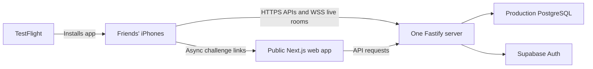

# Brain Battle: get your friends playing through TestFlight

Last checked: November 12, 2026.

This guide takes the current SwiftUI app from your Mac to friends' iPhones. **You need both a hosted game server and a TestFlight build.** TestFlight distributes the app; your hosted server runs the matches. Once both are set up, friends can play over Wi-Fi or cellular while your Mac is off.

You can distribute a beta through TestFlight before publishing a searchable App Store listing. This guide documents the setup; it does not mean a cloud deployment, Apple enrollment, signed upload or beta review has already been completed.

## The order to follow

1. Enroll in the Apple Developer Program.
2. Set up production Supabase Auth and PostgreSQL.
3. Host the existing API and web app at public HTTPS URLs.
4. Put those URLs in the iOS Release configuration.
5. Configure signing and create the app record in App Store Connect.
6. Archive and upload the **BrainBattle app** from Xcode.
7. Test it yourself, then invite friends through an external TestFlight group.

Do the hosting steps before sharing a build. An app installed successfully from TestFlight can still be unable to play if its API is unreachable.

## 1. What you need

| Item                                       | What it is for                                                                                                                                                                              |
| ------------------------------------------ | ------------------------------------------------------------------------------------------------------------------------------------------------------------------------------------------- |
| Mac with a supported Xcode release         | Build, sign and upload the Swift app. Check [Apple's current submission requirements](https://developer.apple.com/news/upcoming-requirements/) before uploading.                            |
| Apple Developer Program membership         | TestFlight distribution. Apple currently lists US$99 per membership year, or local currency where available. See [membership details](https://developer.apple.com/programs/whats-included). |
| An iPhone running iOS 18 or newer          | The current project targets iOS 18+.                                                                                                                                                        |
| A production Supabase project              | Guest authentication, with anonymous sign-ins enabled. It can also host the PostgreSQL database.                                                                                            |
| A public server host                       | Runs Fastify continuously and accepts HTTPS and WebSocket connections.                                                                                                                      |
| A public web deployment                    | Hosts the preserved web app and working async invitation URLs.                                                                                                                              |
| An email address and support/privacy pages | Contact information for testers and the applicable App Store Connect fields.                                                                                                                |

Friends do not need Xcode, a Mac, a paid developer membership or your repository. They install Apple's TestFlight app and accept your invitation. Windows teammates can test on their iPhones this way too. TestFlight does not distribute an Android app. [Apple's tester workflow](https://developer.apple.com/help/app-store-connect/test-a-beta-version/testflight-overview/).

## 2. Understand what stays online



For this repo:

- `apps/ios`: the app Apple distributes.
- `apps/api`: the game server you host yourself.
- `apps/web`: the web app and async challenge landing pages.
- `packages/db`: database schema and migrations.
- `packages/games`: authoritative puzzle generation and scoring, executed on the server.

**Neither `localhost:4000` nor your Mac's Wi-Fi IP is a suitable API address for a friends-and-family TestFlight release.** On a phone, `localhost` means that phone. A private Wi-Fi address is not reachable from your friend's cellular connection.

Use one API instance initially. Live presence and Socket.IO broadcasting are process-local. Multiple API replicas need additional coordination; see [the live architecture notes](apps/ios/LIVE_MULTIPLAYER.md).

## 3. Create your production Supabase project

Use a separate production/beta project so your local recovered database and backups remain untouched.

1. Create a Supabase project and save its database password securely.
2. In its Authentication settings, enable **anonymous sign-ins**. The app creates guest sessions through the backend. See [Supabase's anonymous sign-in guide](https://supabase.com/docs/guides/auth/auth-anonymous).
3. Copy the project URL and its public anon/publishable key for the API server settings.
4. Use the dashboard's **Connect** panel to obtain a PostgreSQL connection URL. For a host without IPv6 access, choose an IPv4-compatible session pooler connection. See [Supabase's connection options](https://supabase.com/docs/guides/database/connecting-to-postgres).
5. Use database credentials with permission to run the repository's migrations and access its tables. The public anon API key is not a PostgreSQL password.

The existing backend applies pending SQL migrations during startup. It creates the original tables and the additive `live_rooms` table in the selected production database. Keep all database credentials server-side. Do not add browser access policies for private puzzle seeds to make a deployment work.

Your local guest and match history will not automatically appear in a new cloud database. Native identities are also isolated by API origin. Expect a new guest profile when switching from your local API to the beta API. Do not overwrite `.env`, copy recovery folders into a host, or reset your local database for this setup.

## 4. Host the API and web app

One concrete route is two Render **Node web services** plus Supabase. Other hosts work if they support a long-running Node process, HTTPS, WebSockets and PostgreSQL connections. Use a service configured to remain available during testing; sleeping services interrupt room availability.

Render supports inbound WebSockets and requires a service to listen on `0.0.0.0` and its assigned port. These are [Render's port-binding instructions](https://render.com/docs/web-services) and [WebSocket instructions](https://render.com/docs/websocket).

### 4A. Make the code available to your host

Connect a private Git repository containing this monorepo to the hosting service. If this folder is not in Git yet, create/push that repository first. Do not upload `node_modules`, `.env`, `.data`, signing secrets or recovery backups. The existing `.gitignore` already excludes common local artifacts.

Use Node 22 or newer as required by `package.json`; the local implementation has been exercised with Node 24. Configure the runtime version in your hosting service.

### 4B. API service

Keep the service's root directory at the **repository root**, so npm can resolve every workspace.

| Setting           | Value                         |
| ----------------- | ----------------------------- |
| Runtime           | Node                          |
| Build command     | `npm ci --include=dev`        |
| Start command     | `npm run start -w @brain/api` |
| Health check path | `/api/health`                 |
| Instance count    | `1`                           |

Set these in the **host's environment variable settings**, not in the app bundle or your local `.env`:

```dotenv
NODE_ENV=production
HOST=0.0.0.0
WEB_ORIGIN=https://YOUR-WEB-HOST
DATABASE_URL=YOUR-PRODUCTION-POSTGRES-CONNECTION-URL
SUPABASE_URL=https://YOUR-PROJECT.supabase.co
SUPABASE_ANON_KEY=YOUR-PROJECT-PUBLIC-ANON-OR-PUBLISHABLE-KEY
SESSION_SECRET=YOUR-LONG-RANDOM-SECRET
```

Let the host provide `PORT`. Fastify already reads it. `WEB_ORIGIN` must be the exact web origin, without a path or trailing slash; it controls allowed browser origins and generated async invitation URLs.

Generate a session secret on your Mac if you need one:

```sh
openssl rand -hex 32
```

Save that value securely in the host. Keep it stable across redeployments so existing signed sessions remain valid. Never put it in Swift, a `NEXT_PUBLIC_` variable or a shared invitation.

Production startup deliberately requires PostgreSQL, Supabase configuration and a non-development session secret. Do not remove those checks to get a beta online. Do not use your Mac's PGlite directory in production or start a second API against it.

### 4C. Web service

Create a second Node web service from the same repository, also with the repository root as its working directory.

| Setting       | Value                                                                                   |
| ------------- | --------------------------------------------------------------------------------------- |
| Build command | `npm ci --include=dev && npm run build -w @brain/web`                                   |
| Start command | `node node_modules/next/dist/bin/next start apps/web --hostname 0.0.0.0 --port "$PORT"` |
| Environment   | `NODE_ENV=production`, `API_URL=https://YOUR-API-HOST`                                  |

`API_URL` must be set when the web service builds: the Next.js configuration uses it to build API rewrites. It must also be available at runtime. After the web address is assigned, update the API's `WEB_ORIGIN` to match it and redeploy the API if needed.

For example, your final public addresses might look like this; these are placeholders, not deployed services:

```text
API: https://brainbattle-api.YOUR-HOST.example
Web: https://brainbattle-web.YOUR-HOST.example
```

The native client talks directly to the API. The web client forwards its `/api` requests to it. Your public proxy must preserve `/api`, `/socket.io`, authorization headers and WebSocket upgrades. Redirecting a native API request to another hostname is not a substitute: the native client rejects redirects to protect credentials.

### 4D. Verify hosting before building the app

Open this address from your iPhone's browser while using cellular data:

```text
https://YOUR-API-HOST/api/health
```

The expected response includes:

```json
{ "ok": true, "auth": "supabase" }
```

Also open the public web app and complete a new guest challenge between two separate browser sessions. Health alone does not verify authentication, database permissions or live WebSockets; test live rooms on phones in step 7.

If HTTPS works but live rooms stay disconnected, inspect the host's WebSocket support, `/socket.io` routing and API logs. Do not deploy this Fastify process as short-lived request functions without redesigning its live scheduler and connection handling.

## 5. Set the iOS Release URLs

Edit **`apps/ios/Configuration/Release.xcconfig`** using your real addresses:

```xcconfig
BRAIN_API_ORIGIN = https:/$()/YOUR-API-HOST
BRAIN_WEB_ORIGIN = https:/$()/YOUR-WEB-HOST
```

Keep the `https:/$()/` syntax: it prevents `.xcconfig` from treating `//` as a comment. It becomes an ordinary `https://` URL in the built app. Use origins only: no `/api` suffix, query string, credentials or trailing path.

The checked-in values are `api.invalid` and `web.invalid`. A build with those values cannot connect. Debug app settings do **not** change the Release URLs. TestFlight uses the Archive action's Release configuration, and the Release app has no development server editor.

Only public origins belong here. The iPhone app does not need your database password, Supabase service-role key or session secret.

## 6. Configure Apple signing and the app record

### 6A. In Xcode

1. Open **`apps/ios/BrainBattle.xcodeproj`**. Open the actual Xcode project, not just the repository folder.
2. Go to **Xcode → Settings → Accounts** and add the Apple Account enrolled in your developer membership.
3. Select the project, then **TARGETS → BrainBattle → Signing & Capabilities**.
4. Enable automatic signing and select your developer team.
5. Choose a unique bundle identifier, such as `com.yourname.brainbattle`. The checked-in `com.brainbattle.BrainBattle` is a development default; availability under your team is not guaranteed.
6. In **General**, choose a version and build number. For your first beta, `0.1.0` and build `1` are a reasonable example. Every subsequent upload should use a new, higher build number.

Use the same bundle identifier consistently. Changing it later creates a different app identity. Keep the project's iOS 18 minimum unless you deliberately implement and test broader compatibility.

**Repo-specific caution:** `scripts/generate-project.py` under `apps/ios` regenerates the project with default bundle identifiers and build numbers. You do not need to run it to archive. If you later use it, preserve your signing/version settings or update the generator first. Save your intentional project configuration changes in source control; keep signing credentials private.

### 6B. In App Store Connect

Go to [App Store Connect](https://appstoreconnect.apple.com), open **Apps**, and add a new iOS app. Enter Brain Battle's available name, primary language, the matching registered bundle ID, and your own internal SKU, for example `brainbattle-ios`.

If the bundle ID is not available in the list, register it under your developer team's Identifiers and confirm Xcode uses that identifier. Apple documents the [new app record workflow](https://developer.apple.com/help/app-store-connect/create-an-app-record/add-a-new-app/). Creating this record does not publish the app.

## 7. Test a Release build on your own iPhone

Before asking friends or reviewers to test:

1. Connect your iPhone to the Mac and select it as Xcode's destination. Trust the Mac and enable Developer Mode if requested for development installation.
2. Choose **Product → Scheme → Edit Scheme → Run → Build Configuration → Release**.
3. Run the app and verify a guest profile can be created through the deployed API. Restore the Run configuration to Debug afterward if you want normal local development back.
4. Turn off Wi-Fi on the phone and verify the game still connects over cellular.
5. Have a second phone/client join a room: test readiness, all five rounds, matching results and rematch.
6. Test an async challenge invitation too. Test backgrounding/reopening, reconnecting, and sharing links.
7. Test while your Mac's local development servers are stopped. The deployed app should continue working.

The current native implementation has been tested locally in Simulators. Production Supabase sessions, your external PostgreSQL deployment and real iPhone behavior still need this deployed check. Avoid uninstalling to troubleshoot a guest session: guest recovery/account linking is limited, so losing credentials can lose access to its history.

## 8. Archive and upload

1. In Xcode, select the **BrainBattle** scheme.
2. Change the destination to **Any iOS Device (arm64)** or the equivalent generic iOS device destination, not an iPhone Simulator.
3. Confirm **Product → Scheme → Edit Scheme → Archive** uses **Release**. The checked-in shared scheme already does.
4. Choose **Product → Archive**.
5. When Organizer opens, select the new BrainBattle archive and validate it if offered.
6. Choose **Distribute App**, then the **App Store Connect** distribution/upload path. Follow the signing and upload prompts. Labels can vary by Xcode version.
7. For friend testing, avoid an option labeled **TestFlight Internal Only**, because you want an externally distributable build.
8. Wait for processing, then open the app's **TestFlight** tab in App Store Connect.

Upload **BrainBattle.app**, not `BrainBattleUITests-Runner`. A Simulator build or an unsigned device compile is not a distributable archive. Do not use the README's `CODE_SIGNING_ALLOWED=NO` compile command for an App Store upload. Apple's [upload documentation](https://developer.apple.com/help/app-store-connect/manage-builds/upload-builds/) covers supported tooling and processing.

Complete any encryption/export questions presented for your build. `Info.plist` currently declares `ITSAppUsesNonExemptEncryption=false`; verify that declaration remains accurate for the app you are actually distributing rather than changing answers merely to bypass a prompt.

## 9. Give friends access through TestFlight

For friends, use **external testing**. Internal testing is intended for App Store Connect team users with access to your app; you do not need to give friends developer/admin access just to play.

In the app's TestFlight tab:

1. Fill in the beta description, feedback email, what to test, and review/contact information requested by Apple.
2. Create an **internal** testing group first, add yourself and the build, and verify the installation through TestFlight on your own iPhone. Apple requires an internal group before you can create an external group.
3. Create an external tester group, for example **Friends & Family**.
4. Add the uploaded build to that group and submit it for beta review when prompted.
5. Once approved and available for external testing, invite friends by email or enable the group's public invitation link. You can keep the group small and share the link privately.

The first submitted external build requires beta review; subsequent builds may also require review. Do not promise a fixed approval time. See [Apple's external tester instructions](https://developer.apple.com/help/app-store-connect/test-a-beta-version/invite-external-testers/).

Suggested review notes to adapt after confirming these details in your build:

```text
Brain Battle is a native multiplayer cognitive game. Registration is not required.
Open the app, choose a guest display name, then use the Games tab → Solo Practice to play
Counting Boxes without another participant.

For live multiplayer, choose Play Live, create a 1v1 or Party room, share its
code with other testers, and have all participants mark Ready. The host starts
the five-round match. Party Mode requires at least three participants.

Async challenges are available through Challenge a Friend. The backend is
publicly hosted and available during review. Only Counting Boxes is playable;
Reaction Time and Sequence Memory are labeled as future games.
```

Provide working support/privacy URLs where requested and describe stored guest identifiers, display names, gameplay records and any hosting/auth data accurately. The checked-in privacy manifest does not automatically fill in App Store Connect's privacy disclosures.

### What your friends do

Send them something like this:

> Install Apple's TestFlight app on your iPhone, then open my beta invitation link. Accept the invite and install Brain Battle. You need iOS 18 or newer and internet access. Open it, pick a guest name, then choose Play Live → Join Room and enter the code I send you. Mark Ready and wait for the host to start.

They do not need to be on your Wi-Fi or enable Developer Mode for the TestFlight installation. A TestFlight build is available for testing for up to 90 days, so upload refreshed builds as needed. [Apple's TestFlight overview](https://developer.apple.com/help/app-store-connect/test-a-beta-version/testflight-overview/).

## 10. Sharing game invitations

There are two different links:

| Link                                   | What it does                                                    |
| -------------------------------------- | --------------------------------------------------------------- |
| TestFlight invitation                  | Installs the beta app. Get this from App Store Connect.         |
| Brain Battle room/challenge invitation | Joins or previews a particular game after the app is installed. |

Live rooms currently support six-character room codes and native links such as `brainbattle://room/ABC234`. Both players need the app installed for native links; entering the room code is a dependable fallback if a messaging app does not open a custom URL scheme.

Async invitations are public web URLs generated from `WEB_ORIGIN`, such as `https://YOUR-WEB-HOST/invite/TOKEN`. They can open the preserved web app. To use one in the native app, paste it into **Have a challenge link?**

Universal links that open the native app directly from HTTPS invitations require your real associated-domain entitlement and a hosted `apple-app-site-association` file. They are not configured automatically by TestFlight. You can run your first beta with room codes and pasted challenge links; see [native configuration notes](apps/ios/README.md#manual-configuration-before-distribution) for that later setup.

## 11. Sending updates

For each app update:

1. Make and check the change locally.
2. Keep API changes compatible with already-installed beta builds, especially versioned game rules and persisted deadlines.
3. Increase the app's build number in Xcode.
4. Archive and upload again.
5. Add that build to the tester group and complete any review steps presented.
6. Tell friends to update from TestFlight.

Backend-only fixes can be deployed separately when compatible with existing clients. Changing a compiled iOS Release URL requires a new app build, so keep your beta API hostname stable. Keep the database and `SESSION_SECRET` stable across deployments as well.

TestFlight testing and public App Store publication are separate steps. A public release needs its own completed store listing and App Review submission; a successful beta upload does not make the game searchable in the App Store.

## Troubleshooting

| Problem                                | What to check                                                                                                                                                                                         |
| -------------------------------------- | ----------------------------------------------------------------------------------------------------------------------------------------------------------------------------------------------------- |
| Installs but cannot connect            | Release URLs still use `.invalid`, HTTP, localhost, a private LAN address, or a nonworking deployment. Debug settings do not override Release.                                                        |
| Works only while your Mac is running   | The phone is still using your Mac's API instead of the hosted API.                                                                                                                                    |
| API fails to start                     | Production database URL, Supabase pair, migration permissions and a valid session secret. Check cloud logs.                                                                                           |
| Health returns `local-development`     | Production environment/auth configuration is wrong; do not invite testers on that setup.                                                                                                              |
| Guests fail to sign in                 | Confirm Supabase anonymous sign-ins, keys, provider logs and rate limits. If CAPTCHA is required, the current native guest flow needs CAPTCHA-token support before that requirement can be satisfied. |
| Database connection is unreachable     | Connection URL, password encoding, network access and whether your host needs an IPv4 session pooler.                                                                                                 |
| Solo works but live stays disconnected | Public WebSocket routing to `/socket.io`, preserved authorization headers, an awake API and one API instance.                                                                                         |
| Archive is unavailable                 | Open the `.xcodeproj`, select BrainBattle and select a generic iOS device instead of a Simulator.                                                                                                     |
| Signing fails                          | Membership, team, bundle ID registration, automatic signing and Apple agreements shown in your account.                                                                                               |
| Upload rejects the build number        | Increment Build and create a new archive.                                                                                                                                                             |
| Friend's invite cannot install         | Group/build assignment, beta approval, build expiration and the phone's iOS version.                                                                                                                  |
| A shared URL opens Safari              | HTTPS universal links are not configured yet; use the room code or native invitation/paste flow.                                                                                                      |
| Existing local history is missing      | The cloud API is a different environment and guest identity scope; local history was not automatically migrated.                                                                                      |

## Your first-beta checklist

- [ ] Apple Developer membership active; correct team and unique bundle ID selected.
- [ ] Production Supabase anonymous guest sign-in works.
- [ ] Production PostgreSQL is connected and migrations applied.
- [ ] Exactly one public API instance is running with HTTPS and WebSocket support.
- [ ] Public web app works; `WEB_ORIGIN` and `API_URL` match the deployments.
- [ ] Release URLs contain real HTTPS origins, without `/api` suffixes.
- [ ] A Release build works on your iPhone over cellular while your Mac servers are off.
- [ ] Two players complete live 1v1 and async challenges; party testers complete a party.
- [ ] Reconnect, results, sharing and rematch checked on phones.
- [ ] Version/build, signing, review notes and requested privacy/contact fields completed.
- [ ] Signed BrainBattle archive uploaded, processed and approved for external testing.
- [ ] Friends install using the TestFlight invitation, then join using a game room code.

No production deployment, enrollment, upload or review submission is performed by following a documentation link alone. Keep local `.env`, `.data` and recovery backups intact throughout these steps.
