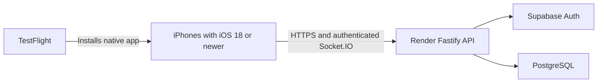

# Brain Battle: native iPhone beta through TestFlight

Updated November 12, 2026. **This beta requires no Next.js website deployment.**

Your infrastructure is already configured:

- GitHub: `erictang2006/BrainBattle`
- API: `https://brain-battle-api.onrender.com`
- Health: `https://brain-battle-api.onrender.com/api/health`
- Supabase anonymous authentication and your configured PostgreSQL database

The next step is to sign, archive and upload the native iOS app. TestFlight distributes that app; Render keeps the multiplayer server running. Your Mac can be off while friends play.

## 1. What the beta uses



The Next.js application remains in the repository and continues to support its existing web flows. It is optional for this native beta. Do not create a web deployment, change the local `.env`, reset a database, or copy recovery backups to Render to prepare this build.

Run one API instance initially: live presence and broadcasts are process-local. The current backend already has the native sessions, live-room and async invitation endpoints the app needs.

## 2. How friends invite each other

### Live 1v1 and Party Mode

1. Open **Play Live** and choose 1v1 or Party Mode.
2. Create a room and tap the share button.
3. The native share sheet sends a **six-character room code** and instructions.
4. Your friend opens **Play Live → Join Room**, enters the code and marks Ready.
5. The host starts after the required players are connected and ready: exactly two for 1v1, at least three for a party, up to its chosen limit of eight.

The share message contains text, not a website URL. The join field accepts a plain room code or the complete message produced by the app. Existing `brainbattle://room/CODE` links remain compatible, but the beta does not depend on custom link handling or universal links.

### Async friend challenges

1. Choose **Challenge a Friend**.
2. Complete your rounds, or share the invitation before finishing.
3. Tap **Share challenge**. The message includes a **48-character challenge code**.
4. Your friend opens **Have a challenge code?**, pastes the code or complete shared message, previews the invitation and accepts it.

Async codes retain the existing 192-bit invitation token rather than reducing it to a guessable six-character room code. Preview and redemption call the API directly. The server still enforces expiration, one challenger, membership, scoring and finalized results. A claimed invitation can be reopened only by the existing participants. Async rematches generate fresh invitations; live rematches create a shared fresh lobby.

For compatibility, the existing server response still contains an `inviteUrl`. The native app extracts its validated token locally and shares only the code and instructions. It never opens or fetches that URL. Existing web clients continue receiving the original URL contract. No new database schema or migration is needed.

Treat an unclaimed challenge code like an invitation: anyone you give it to can try to claim its one challenger slot.

## 3. Release configuration is ready

`apps/ios/Configuration/Release.xcconfig` now contains:

```xcconfig
BRAIN_API_ORIGIN = https:/$()/brain-battle-api.onrender.com
BRAIN_WEB_ORIGIN = $(BRAIN_API_ORIGIN)
```

The unusual slash syntax prevents `.xcconfig` from interpreting `//` as a comment. Both values resolve to `https://brain-battle-api.onrender.com` in the built app. `BRAIN_WEB_ORIGIN` is only a compatibility origin for parsing legacy invitations; it does not cause website requests.

Debug builds keep `localhost:4000` for the API and the existing local web origin for optional development. Debug server preferences do not override a Release build. To test the hosted configuration from Xcode, use a Release run configuration or the Release tests below.

The iOS app contains no database password, session signing secret, Supabase service-role key or server environment file. Its opaque native session stays in Keychain. Gameplay generation, deadlines, scores and results remain authoritative on the API.

### Render settings to keep

- `NODE_ENV=production`
- `DATABASE_URL` pointing to your intended production PostgreSQL database
- Both Supabase authentication settings, with anonymous sign-ins enabled
- The existing stable `SESSION_SECRET`
- `HOST=0.0.0.0` and the host-provided `PORT`
- One API instance and working `/socket.io` WebSocket routing

`WEB_ORIGIN` remains a backend compatibility setting for browser CORS and legacy invitation URLs. It does not require a deployed website for native clients. Native code sharing works even when that legacy URL has no public website behind it. You do not need to change an already-working API configuration solely to enable native invitations.

Use a server plan appropriate for the beta's availability needs. Render's free instances idle-sleep; paid compute does not idle-sleep. [Render's service behavior](https://render.com/docs/faq).

## 4. Apple account and signing: still manual

You need an active Apple Developer Program membership to distribute through TestFlight. Apple currently lists US$99 per membership year or local currency where available. Friends only need TestFlight, their Apple Account and a compatible iPhone. [Membership details](https://developer.apple.com/programs/whats-included).

Check [Apple's current upload requirements](https://developer.apple.com/news/upcoming-requirements/) before archiving with your installed Xcode.

Current project values:

| Setting               | Current value                              | What you must do                                                                                |
| --------------------- | ------------------------------------------ | ----------------------------------------------------------------------------------------------- |
| Project               | `apps/ios/BrainBattle.xcodeproj`           | Open this project, not just the repository folder.                                              |
| Scheme                | `BrainBattle`                              | Keep the app scheme selected.                                                                   |
| Minimum iOS           | `18.0`                                     | Testers need iOS 18 or newer.                                                                   |
| Bundle identifier     | `com.brainbattle.BrainBattle`              | Confirm it is available/registered under your Apple team, or choose your own unique identifier. |
| Version               | `0.1.0`                                    | Keep or set your intended beta version.                                                         |
| Build                 | `1`                                        | Increase if you already uploaded this build number.                                             |
| Signing               | Automatic, no development team checked in  | Select your enrolled team in Xcode.                                                             |
| Icon                  | `AppIcon`, 1024×1024 PNG, no alpha channel | Already present; no icon redesign needed.                                                       |
| Archive configuration | Release                                    | Already set in the shared scheme.                                                               |

In Xcode:

1. Add your Apple Account under **Xcode → Settings → Accounts**.
2. Select the project, then **TARGETS → BrainBattle → Signing & Capabilities**.
3. Select your team and enable automatic signing.
4. Confirm your bundle identifier and the General tab's Version and Build.

Do not disable signing for the upload. The unsigned device compile described in validation only checks compilation; it is not an installable or uploadable archive.

**Project generator caution:** `apps/ios/scripts/generate-project.py` generates default signing/version settings. It is not needed for archiving. Preserve your team, identifier and version settings if regenerating later.

## 5. Create or select the App Store Connect record

In [App Store Connect](https://appstoreconnect.apple.com), open **Apps**. Create a new iOS app if needed using the same bundle identifier as Xcode. Choose an available name, primary language and internal SKU, such as `brainbattle-ios`.

Creating the record does not publish a searchable App Store listing. [Apple's app record instructions](https://developer.apple.com/help/app-store-connect/create-an-app-record/add-a-new-app/).

## 6. Check the Release app on your iPhone

Simulator checks do not replace this physical-device step:

1. Connect and unlock your iPhone; trust the Mac and enable Developer Mode if requested for development installation.
2. Select your phone as the Xcode destination.
3. In **Product → Scheme → Edit Scheme → Run**, temporarily choose **Release**.
4. Run, create or restore your guest profile, and try a solo round.
5. Turn off Wi-Fi and verify the app connects over cellular.
6. With another tester, check live 1v1, a party, async code acceptance, five-round results and rematches.
7. Check backgrounding and reconnecting; deadlines must remain unchanged.
8. Verify the share sheets contain codes and instructions, with no nonexistent web link.
9. Confirm the game still works while your Mac's local development servers are stopped.

Restore Run to Debug afterward if you want normal localhost development back. Archive remains Release independently.

Guest credentials are scoped to the API origin. Switching from localhost to the hosted API can create a new guest profile; it does not migrate local history. Do not delete `.env`, databases or backups to resolve this expected environment separation. Avoid uninstalling a guest app as a first troubleshooting step: account linking/recovery is limited.

## 7. Archive and upload

1. Select the **BrainBattle** scheme.
2. Select **Any iOS Device (arm64)** or the equivalent generic device destination, not a Simulator.
3. Confirm **Edit Scheme → Archive → Release**.
4. Choose **Product → Archive**.
5. In Organizer, select the archive and validate it if offered.
6. Choose **Distribute App → App Store Connect** and follow the upload/signing prompts. Labels vary by Xcode version.
7. Avoid **TestFlight Internal Only** if you want to distribute this build to friends as external testers.
8. Wait for processing, then find the build under the app's **TestFlight** tab.

Upload the BrainBattle app, not `BrainBattleUITests-Runner`. A Simulator build cannot be submitted. [Apple's upload instructions](https://developer.apple.com/help/app-store-connect/manage-builds/upload-builds/).

Complete any export/encryption questions accurately. `Info.plist` currently declares `ITSAppUsesNonExemptEncryption=false`; confirm that remains accurate for the build you distribute. Fill in requested contact and privacy information for your actual data practices. The included privacy manifest does not automatically complete App Store Connect's privacy forms.

## 8. Invite friends

1. Create an **internal testing group** first, add yourself and the uploaded build, and install through TestFlight on your own iPhone.
2. Create an **external testing group**, such as Friends & Family.
3. Add the build, beta description, feedback/contact details and what to test.
4. Submit for beta review when prompted.
5. Once approved and available, invite friends by email or enable a public invitation link and share it privately.

Apple requires an internal group before creating an external group. The first submitted external build requires review; later builds may also require review. Do not give friends developer/admin access just to test. [Apple's external testing instructions](https://developer.apple.com/help/app-store-connect/test-a-beta-version/invite-external-testers/).

Suggested review notes, after you verify the details on a phone:

```text
Brain Battle is a native cognitive mini-game app. Registration is not required.
Choose a guest name, then use Games → Solo Practice to play Counting Boxes alone.

Live multiplayer uses Play Live and six-character room codes. All participants
mark Ready before the host starts. 1v1 needs two players; Party Mode needs three
to eight. Async challenges use a copyable challenge code entered through
“Have a challenge code?” in the native app. No website is required.

The backend is publicly hosted. Only Counting Boxes is playable; Reaction Time
and Sequence Memory remain future games. Results and rematches are available.
```

Message for friends:

> Install Apple's TestFlight app, open my beta invitation, and install Brain Battle. You need iOS 18 or newer and internet access. Pick a guest name. For live games, go to Play Live → Join Room and enter the six-character code I send you, then mark Ready. For an async challenge, use Have a challenge code? and paste the longer code or shared message.

The TestFlight invitation installs the app; a room or challenge code joins a game. These are different invitations. Friends do not need your Wi-Fi, Xcode, a Mac or a paid developer membership. TestFlight builds can be tested for up to 90 days; upload refreshed builds as needed. [Apple's TestFlight overview](https://developer.apple.com/help/app-store-connect/test-a-beta-version/testflight-overview/).

## 9. Updates and optional web support

For a new iOS build, increment Build, archive again, upload and assign it to the tester group. Keep backend changes compatible with already-installed clients and persisted/versioned matches. Keep the API hostname, database and session secret stable.

The existing website remains available for optional local development or a future web deployment. No web files, routes or cookie contracts were removed. Native links and pasted legacy links remain compatible where configured; universal links are not needed for this beta.

**Redeploy the existing Render API once to apply the final reliability fixes:** room creation and rematches now retry room-code collisions atomically, and expired rooms return a clear terminal response. No new Render service, website, environment variable, database reset or migration is required. The deployed API already supports native invitations and gameplay; the redeploy applies these additional safeguards. Uploading the iOS app alone does not update backend code.

## 10. Validation and remaining work

Validation results for this change are recorded in [NATIVE_BETA_READINESS.md](apps/ios/NATIVE_BETA_READINESS.md). That report distinguishes executed checks from remaining manual configuration, device testing and upload.

Useful commands from the repository root:

```sh
npm test
npm run typecheck

# Explicitly creates three fresh test guests and new test games on this API.
# Does not contact a website, access the database directly, or print credentials.
node --import tsx scripts/check-hosted-beta.ts https://brain-battle-api.onrender.com

# Release unit/integration tests and native-only UI smoke on a chosen Simulator.
# ENABLE_TESTABILITY is for these tests only; leave normal Archive settings unchanged.
xcodebuild -project apps/ios/BrainBattle.xcodeproj -scheme BrainBattle \
  -configuration Release -destination 'platform=iOS Simulator,id=YOUR_SIMULATOR_UDID' \
  -derivedDataPath apps/ios/build/NativeBetaRelease ENABLE_TESTABILITY=YES \
  -only-testing:BrainBattleTests -only-testing:BrainBattleUITests/NativeBetaUITests test
```

Before inviting friends, confirm:

- [ ] Enrolled Apple team and registered bundle identifier selected.
- [ ] Version/build unique for the next upload.
- [ ] Release tested on real phones over cellular, including code sharing and multiplayer.
- [ ] Signed archive uploaded and processed.
- [ ] Requested review/contact/privacy information completed.
- [ ] External beta approval and tester group/build assignment complete.

A TestFlight beta is separate from public App Store publication. This guide does not claim an upload or Apple approval has happened.
